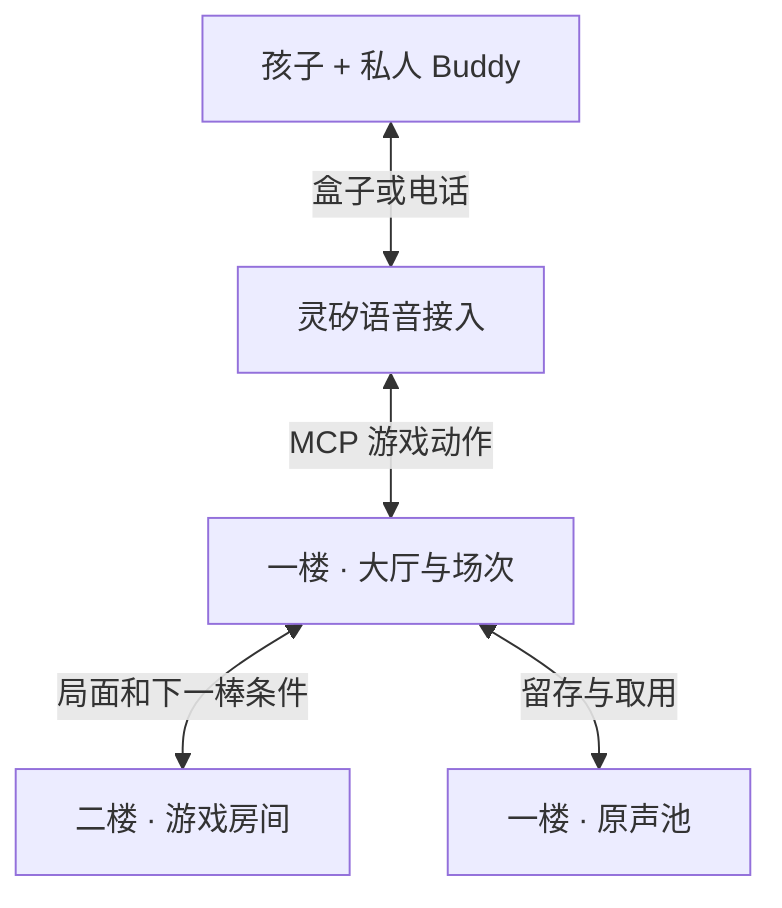

# 游戏大厅架构与第一期计划

每个孩子带着自己的 Buddy，通过盒子或电话进入大厅。故事接龙是第一间房。玩家接完一句，当轮可以由在线伙伴接话、由历史原声接话，或由 Buddy 接话。

## 模块图

| 模块 | 做什么 | 目前做到哪 |
| --- | --- | --- |
| 灵矽语音接入 | 唤醒、收音、转写、给当前玩家出声。Buddy 提示和陪玩，孩子可以停播、退出或换游戏。MCP 传游戏动作，音频走语音通道。 | 单通电话能进大厅、开局、提交发言。电话原声接话和真机定向播放待验收。 |
| 大厅与场次 | 选房、等待匹配、安排座位和发言权。采用半双工轮流通道，每次一人说，下一位听完接棒。好友邀约也在这一层。 | 三个浏览器可模拟三分钟匹配、中途加入、轮流接话和本机停播。好友身份与邀约待做。 |
| 游戏原声池 | 每个游戏服务留存本游戏获准复用的原声及索引。玩家想跟人玩但没匹配到，或者主动选择历史伙伴时使用。 | 浏览器版已按语境跨局复用，并支持历史席位逐棒取音、本局不重复、不取自己的录音。电话版已保存发言索引，随机选取和回退 Buddy 已通过本地测试。两条试跑路径暂用各自的池。 |
| 游戏房间 | 定义规则、进度和下一棒需要什么。故事接龙要判断一句话能不能接上当前情节，二十问可以给出自己的复用条件。 | 已有故事接龙规则。电话版按主题和文字关联找候选，再由智能体筛选。明确的回合条件待加。 |

**一轮怎么走**　孩子说完一句 → 房间更新故事并给出下一棒的条件 → 大厅安排在线伙伴接话，或在单人局里查历史原声 → 有合适原声就当作队友这一棒，否则由 Buddy 接话 → 孩子继续。

**代码放哪**　游戏侧 Demo 在 `story-relay-mcp`，平台设计文档在 `GamingPlatform`。浏览器入口用 `lobby.go`、`lobby_pool.go`，电话入口用 `call_demo.go`、`call_pool.go`。`xrobotd` 提供灵矽设备会话、Buddy 和媒体采播。单电话 Demo 使用现有 MCP 与播放接口，三盒真机接入需要灵矽提供逐设备播放能力。

**原声放哪**　在线发言用短时缓冲。获准复用的原声计划进私有对象存储，大厅保留条件、权限和音频引用。电话 Demo 已用私有存储准备过单条原声，浏览器 Demo 用本地文件。

## 第一阶段怎么做

| 顺序 | 要实现的事 | 怎么验收 |
| --- | --- | --- |
| 1 | **先做原声池。** 房间给出可复用条件，比如「森林冒险里，回答树洞有什么声音」。池保存条件和音频引用，原声可读后进入可选列表。 | 用两条合格原声和一条同主题但答非所问的素材验收。新局从合格录音中随机取一条，空池由 Buddy 接。 |
| 2 | **跑一通真实电话。** 用现有 MCP 接上选中的原声，分别观察候选数、筛选结果、音频可读和播放请求。 | 第一局留下原声，第二局正常接一句，在电话里听见旧原声自然接话，并能接着这句话继续编。 |
| 3 | **接三台真机。** 接上成员身份、原声采集、指定盒子播放、实际播完回执和停播。把好友邀约接到同一套入座逻辑。 | 三台能按三分钟规则匹配和中途加入，好友能相约同局。在播放中退出能回到 Buddy。 |

用第二个房间检验扩展边界。新增二十问时，新增它的规则及复用条件，同一个大厅、场次和原声池继续服务。
